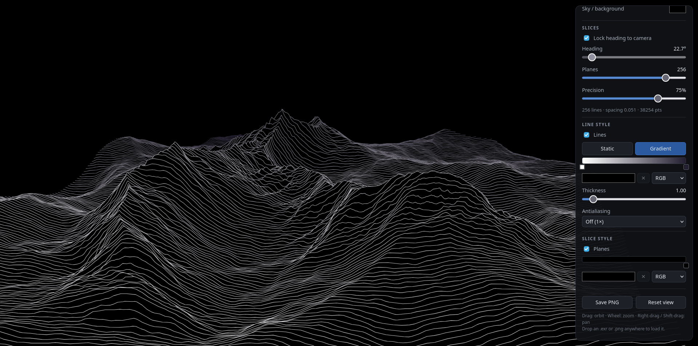

# Terrain Slicer

A web tool for viewing terrain as **ridge-line slices**: many parallel, evenly
spaced vertical planes intersect the terrain, and the intersection curves are
rendered far-to-near so that nearer lines occlude farther ones (everything
below a drawn line is erased) — the classic "ridge plot" look, rendered live
in 3D.



## Run

```sh
npm install
npm run dev        # http://127.0.0.1:5173
```

Production build: `npm run build` (output in `dist/`, serve with any static server).

## Usage

- **Camera** — drag: orbit (elevation is locked to positive angles, you can
  never look at the terrain from below), wheel: zoom, right-drag / Shift-drag:
  pan.
- **Shaded view** — a simple lit view of the terrain, just to see it.
- **Slices view** — the output view (default), with these controls:
  - *Lock heading to camera* — planes stay orthogonal to the camera heading
    while you orbit. Uncheck to set the heading manually.
  - *Heading* — azimuth of the plane normals (0–360°).
  - *Planes* — number of planes; the resulting spacing is shown in the status
    line.
  - *Precision* — line decimation: 100% keeps every grid sample (finest
    lines), lower values merge near-collinear points into longer segments
    (faster, chunkier). Regardless of this setting, long segments are
    adaptively subdivided at render time and midpoint-tested against the
    curtains, so occlusion boundaries resolve to a few pixels and segments
    never pop in or out as a whole.
  - *Occlusion* — nearer slice lines hide farther ones exactly where the
    nearer slice's **plane below its curve** covers them: each slice acts as
    an opaque curtain from its curve down to the ground, and the space
    between adjacent planes is empty, so looking between planes shows what is
    behind them. This is implemented with a small GPU depth prepass: the
    curtains are rendered from the active camera each frame and every curve
    point is depth-tested against them, which stays correct from any view
    direction (top-down, parallel to the planes, zoomed in, …) while being
    faster than per-line screen-space erasing.
  - *Line style* — *Lines* toggle; color mode as two joined buttons,
    **Static** (flat color) or **Gradient** (palette by distance); thickness;
    and antialiasing (off/2×/3×/4× supersampling).
  - *Slice style* — *Planes* toggle (the curtains below the lines) and its own
    gradient palette, always distance-based (nearest bands `#241f31`, fading
    to black in the distance).
  - **Palette editor** (Gradient mode) — click the gradient bar to add stops,
    drag stops to move them, double-click a stop to open the color picker,
    right-click a stop to delete it, and interpolate between stops in RGB or
    HSV. The nearest slice maps to the left end of the palette and the
    farthest to the right end. The sky keeps its own background color (View
    section).
- **Projection** — slider from full perspective to true orthographic. Framing
  is preserved while blending.
- **Terrain** — load via the button or by dropping a file anywhere:
  - **OpenEXR heightmap** (`.exr`, half/float, single-channel "Y" or RGB; the
    first channel is used as height),
  - **PNG heightmap** including 16-bit PNGs (grayscale or RGB; first channel
    is used).
  Heights are normalized to the file's min..max range; *Height scale* sets the
  world-space height as a percentage of the terrain width.
- **Save PNG** — exports the current view. In slices mode the view is
  re-rendered offscreen at 2× supersampling (or at the selected
  supersampling level when higher), with the background color baked in.

A built-in procedural sample terrain loads at startup so you can play with the
slices immediately. `npm run gen-samples` writes test heightmaps
(8/16-bit PNG and EXR) into `samples/`.

## Notes / limits

- Interlaced PNGs are not supported by the decoder.
- Slices are resampled at the heightmap's grid resolution (capped at a total
  sample budget per recompute), and near-collinear points are decimated with
  Douglas-Peucker, so extremely dense line counts stay interactive.
- At grazing camera angles a single slice's curve can visually fold over
  itself; the painter-style occlusion used here (like all such plots) does not
  resolve that case.
